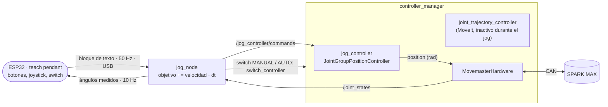

# movemaster_teleop

Jog de articulaciones de MoveMaster desde el teach pendant (ESP32): con el botón
de cada articulación se elige cuál mover y el joystick la mueve, más rápido cuanto
más se inclina. Hoy el pendant se conecta por USB/UART; después, por el bus CAN.



## Cómo funciona el jog

El SPARK MAX sigue en control de posición, igual que con MoveIt. Lo único que
cambia es quién mueve el objetivo: cada 20 ms, `jog_node` avanza el objetivo de
cada articulación seleccionada `velocidad · dt`, con la velocidad proporcional a
la inclinación del joystick.

| Acción | Resultado |
|---|---|
| Inclinar poco | El objetivo avanza despacio y la articulación lo sigue sin parar |
| Inclinar a fondo | La articulación va a `max_speed_rad_s` |
| Soltar | El objetivo se detiene y el SPARK **sostiene** la articulación ahí, también contra la gravedad |
| Articulación bloqueada | El objetivo no se adelanta más de `max_lead_rad` a la posición medida: no salta al liberarse |
| Límite de `joints.json` | El objetivo se detiene en el límite |
| Se desconecta el pendant | Sin tramas por `link_timeout_s`: velocidad 0, las articulaciones se sostienen |

Cada sesión de jog parte de las posiciones medidas (`/joint_states`), así que
nunca vuelve a objetivos viejos aunque el `joint_trajectory_controller` haya
movido el brazo entre tanto.

El joystick Y mueve la articulación elegida con los botones J1, J2 o J3; el X,
la elegida con J4 o J5, como los grupos del panel del pendant. Puede haber una
articulación X y una Y seleccionadas a la vez. Las articulaciones que no están en `joints.json` se
ignoran.

## Compilar

Desde `movemaster_ws/`:

```bash
source /opt/ros/jazzy/setup.bash
rosdep install --from-paths src src/movemaster_ros/movemaster_ros --ignore-src -r -y
colcon build --symlink-install --packages-up-to movemaster_bringup --cmake-args -DCMAKE_BUILD_TYPE=Release
source install/setup.bash
```

`rosdep` instala `position_controllers` (el `jog_controller`) y `python3-serial`.
El puerto serie requiere el grupo `dialout`, una sola vez:
`sudo usermod -aG dialout $USER` y volver a iniciar sesión.

## Usar

Todo junto, con el puerto del ESP32 (`ls /dev/ttyUSB* /dev/ttyACM*`):

```bash
ros2 launch movemaster_bringup bringup.launch.py pendant:=/dev/ttyUSB0
```

O por separado: `ros2 launch movemaster_control movemaster_control.launch.py`,
que carga el `jog_controller` **inactivo**, y en otra terminal
`ros2 launch movemaster_teleop jog.launch.py port:=/dev/ttyUSB0`.

El switch del pendant elige el controlador; solo uno puede mandar las
articulaciones:

| Switch | Qué hace `jog_node` |
|---|---|
| MANUAL | Activa el `jog_controller` y desactiva el `joint_trajectory_controller`. El botón de una articulación la selecciona y el joystick la mueve. Si hay una trayectoria en curso, espera a que termine. |
| AUTO | Devuelve las articulaciones al `joint_trajectory_controller` (MoveIt). |
| Sin tramas (pendant desconectado) | No cambia de controlador: el jog se detiene y el brazo se sostiene. |

Si un fallo del hardware desactiva los dos controladores, el switch no hace nada
hasta que se recupera el brazo (MANUAL §12). Con `select_controllers: false` los
controladores se cambian a mano con `ros2 control switch_controllers`.

`jog_node` es el único que lee el puerto del pendant. Publica cada trama en
`/pendant/joy` (`sensor_msgs/Joy`: `axes` = joystick X e Y, de -1 a 1; `buttons` =
MANUAL, gripper, articulación X y articulación Y) para quien necesite mostrarla,
como el HMI.

`ros2 control list_controllers` muestra cuál está activo. El log de `jog_node`
dice cuándo se conecta el pendant, qué articulaciones están seleccionadas y qué
controlador manda.

El **botón del joystick** abre y cierra el gripper, en MANUAL y en AUTO: el
pendant alterna su bandera `gripper` con cada presión, y `jog_node` publica en
`/gripper_controller/commands` 0 (cerrar) cuando se activa y 1 (abrir) cuando se
desactiva (`movemaster_teleop/gripper.py`). Solo cuenta un cambio: la primera
trama tras conectar o reconectar el pendant no mueve la pinza.

### Probar sin el ESP32

`pendant_sim` imita al pendant en un puerto serie virtual:

```bash
ros2 run movemaster_teleop pendant_sim          # imprime el puerto, por ejemplo /dev/pts/3
ros2 launch movemaster_teleop jog.launch.py port:=/dev/pts/3
```

Habla texto, como el firmware de `hmi/esp32/`; con `--binary`, tramas como el de
`firmware/` (entonces `protocol: binary` en `jog.yaml`). Comandos: `manual` y
`auto` (el switch; arranca en AUTO), `sel 4 1` (articulación X, articulación Y),
`x 300`, `y -500` (-1000…1000), `0` (soltar), `grip` (el botón del joystick),
`angles` (los últimos ángulos que mandó `jog_node`), `q`. Con `use_mock_hardware:=true` se prueba toda la
cadena sin motores.

## Parámetros (`config/jog.yaml`)

| Parámetro | Defecto | Significado |
|---|---|---|
| `protocol` | `text` | Lo que manda el ESP32: `text` (`hmi/esp32/main.cpp`) o `binary` (`firmware/`) |
| `angles_rate_hz` | `10.0` | Solo `text`: cada cuánto se le mandan al ESP32 los ángulos medidos; `0`, nunca |
| `x_joints`, `y_joints` | `[4, 5]`, `[1, 2, 3]` | Qué articulaciones mueve cada eje del joystick: los grupos de botones del panel. El HMI los muestra igual |
| `max_speed_rad_s` | `0.25` cada una | Velocidad a fondo, J1…J5; nunca más que `max_velocity_rad_s` de `joints.json` |
| `deadband` | `0.12` | Fracción del recorrido del joystick que no mueve nada |
| `max_lead_rad` | `0.05` | Cuánto puede adelantarse el objetivo a la articulación |
| `link_timeout_s` | `0.2` | Sin tramas por este tiempo, se detiene el jog |
| `idle_timeout_s` | `1.0` | Tras este tiempo sin movimiento, el siguiente jog parte de las posiciones medidas |
| `select_controllers` | `true` | El switch MANUAL/AUTO cambia de controlador; `false`, se cambian a mano |
| `switch_retry_s` | `2.0` | Espera antes de reintentar un cambio que el `controller_manager` rechazó |

La curva es cuadrática: a media inclinación, un cuarto de la velocidad, para
tener precisión cerca del centro.

## Lo que manda el pendant

Hay dos protocolos; `jog_node` convierte los dos en la misma `PendantFrame`, así
que el resto (jog, cambio de modo, gripper, `/pendant/joy`) no distingue cuál es.

### Texto (`protocol: text`, el firmware de `hmi/esp32/main.cpp`)

Legible en un monitor serie. Cada 20 ms un bloque:

```text
Freedrive: ON
Joint Y: J1 | Angulo: 12.3 grados | Joystick Y: -450
Joint X: J4 | Angulo: -5.0 grados | Joystick X: 0
Gripper: OFF
-------------------------
```

`Freedrive` es el switch MANUAL/AUTO; `Joystick`, de −1000 a 1000 alrededor del
centro calibrado al encender (0 en AUTO); `Gripper`, el estado que alterna el
botón del joystick (ON cierra). Como el texto no lleva CRC, `jog_node` solo
acepta un bloque completo y en orden: una línea rara descarta el bloque entero.

En sentido contrario, `jog_node` le manda al ESP32 los ángulos medidos
(`/joint_states`) en grados con Home en 0, y el ESP32 los muestra en `Angulo`:

```text
ANGLES,12.3,-20.5,33.3,0.0,45.0
```

El formato está en `movemaster_teleop/pendant_text.py` y en `hmi/esp32/main.cpp`:
si cambia uno, cambia el otro.

### Binario (`protocol: binary`, el firmware de `firmware/`)

8 bytes, el payload de una trama CAN clásica. Por USB/UART va precedida de `0xA5`.

| Byte | Campo |
|---|---|
| 0 | Contador de secuencia |
| 1 | Banderas: bit 0 MANUAL, bit 1 gripper |
| 2 | Selección: nibble alto articulación X, nibble bajo articulación Y (0 = ninguna) |
| 3–4 | Joystick X, int16 little-endian, −1000…1000 |
| 5–6 | Joystick Y, int16 little-endian, −1000…1000 |
| 7 | CRC-8 (polinomio 0x07, inicio 0) de los bytes 0–6 |

Está definida en `movemaster_teleop/pendant_frame.py` y en `firmware/src/main.cpp`.
Es la que convendrá al pasar el pendant al bus CAN.
Para pasar a CAN solo cambia el transporte: en la Pi, un `CanLink` junto a
`SerialLink` en `pendant_link.py`; en el ESP32, `enviarTrama()` con el
controlador TWAI integrado y un transceptor de 3.3 V (SN65HVD230 o MCP2562).

## Firmware del ESP32

El vigente es el de texto, `hmi/esp32/main.cpp` (en la raíz del repositorio).
El de `firmware/` es el binario, un proyecto PlatformIO: con el ESP32 conectado,
`cd firmware && pio run -t upload`. Los dos:

- Al encender calibra el centro del joystick: no lo toques durante el primer
  cuarto de segundo.
- Fuera de MANUAL envían el joystick en 0.
- El de texto arranca con J1 (Y) y J4 (X) seleccionadas; el binario, sin ninguna
  hasta pulsar un botón.
- En el binario, `#define PENDANT_DEBUG 1` imprime texto legible en lugar de
  tramas, e `invertirX` / `invertirY` corrigen un joystick montado al revés.

## Seguridad

- El paro de emergencia del pendant debe cortar la alimentación de los motores
  por hardware, sin pasar por el ESP32 ni por ROS.
- El jog no es una parada: deshabilitar o soltar el joystick deja el brazo
  sostenido, no sin energía.
