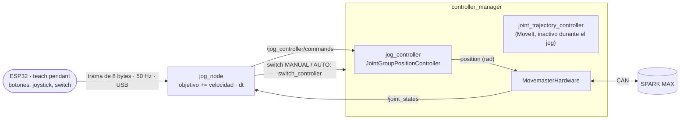

# movemaster_teleop

Jog de articulaciones de MoveMaster desde el teach pendant (ESP32): con el botón
de cada articulación se elige cuál mover y el joystick la mueve, más rápido cuanto
más se inclina. Hoy el pendant se conecta por USB/UART; después, por el bus CAN.



## Cómo funciona el jog

El SPARK MAX sigue en control de posición, igual que con MoveIt. Lo único que
cambia es quién mueve el objetivo: cada 20 ms, `jog_node` avanza el objetivo de
cada articulación seleccionada `velocidad · dt`, con la velocidad proporcional a
la inclinación del joystick.

| Acción | Resultado |
|---|---|
| Inclinar poco | El objetivo avanza despacio y la articulación lo sigue sin parar |
| Inclinar a fondo | La articulación va a `max_speed_rad_s` |
| Soltar | El objetivo se detiene y el SPARK **sostiene** la articulación ahí, también contra la gravedad |
| Articulación bloqueada | El objetivo no se adelanta más de `max_lead_rad` a la posición medida: no salta al liberarse |
| Límite de `joints.json` | El objetivo se detiene en el límite |
| Se desconecta el pendant | Sin tramas por `link_timeout_s`: velocidad 0, las articulaciones se sostienen |

Cada sesión de jog parte de las posiciones medidas (`/joint_states`), así que
nunca vuelve a objetivos viejos aunque el `joint_trajectory_controller` haya
movido el brazo entre tanto.

El joystick X mueve la cintura y la muñeca (J1, J5); el Y, el hombro, el codo y
el pitch de la muñeca (J2, J3, J4). Puede haber una articulación X y una Y
seleccionadas a la vez. Las articulaciones que no están en `joints.json` se
ignoran.

## Compilar

Desde `movemaster_ws/`:

```bash
source /opt/ros/jazzy/setup.bash
rosdep install --from-paths src src/movemaster_ros/movemaster_ros --ignore-src -r -y
colcon build --symlink-install --packages-up-to movemaster_bringup --cmake-args -DCMAKE_BUILD_TYPE=Release
source install/setup.bash
```

`rosdep` instala `position_controllers` (el `jog_controller`) y `python3-serial`.
El puerto serie requiere el grupo `dialout`, una sola vez:
`sudo usermod -aG dialout $USER` y volver a iniciar sesión.

## Usar

Todo junto, con el puerto del ESP32 (`ls /dev/ttyUSB* /dev/ttyACM*`):

```bash
ros2 launch movemaster_bringup bringup.launch.py pendant:=/dev/ttyUSB0
```

O por separado: `ros2 launch movemaster_control movemaster_control.launch.py`,
que carga el `jog_controller` **inactivo**, y en otra terminal
`ros2 launch movemaster_teleop jog.launch.py port:=/dev/ttyUSB0`.

El switch del pendant elige el controlador; solo uno puede mandar las
articulaciones:

| Switch | Qué hace `jog_node` |
|---|---|
| MANUAL | Activa el `jog_controller` y desactiva el `joint_trajectory_controller`. El botón de una articulación la selecciona y el joystick la mueve. Si hay una trayectoria en curso, espera a que termine. |
| AUTO | Devuelve las articulaciones al `joint_trajectory_controller` (MoveIt). |
| Sin tramas (pendant desconectado) | No cambia de controlador: el jog se detiene y el brazo se sostiene. |

Si un fallo del hardware desactiva los dos controladores, el switch no hace nada
hasta que se recupera el brazo (MANUAL §12). Con `select_controllers: false` los
controladores se cambian a mano con `ros2 control switch_controllers`.

`ros2 control list_controllers` muestra cuál está activo. El log de `jog_node`
dice cuándo se conecta el pendant, qué articulaciones están seleccionadas y qué
controlador manda.

### Probar sin el ESP32

`pendant_sim` imita al pendant en un puerto serie virtual:

```bash
ros2 run movemaster_teleop pendant_sim          # imprime el puerto, por ejemplo /dev/pts/3
ros2 launch movemaster_teleop jog.launch.py port:=/dev/pts/3
```

Comandos: `manual` y `auto` (el switch; arranca en AUTO), `sel 1 2` (articulación X, articulación Y), `x 300`, `y -500`
(-1000…1000), `0` (soltar), `q`. Con `use_mock_hardware:=true` se prueba toda la
cadena sin motores.

## Parámetros (`config/jog.yaml`)

| Parámetro | Defecto | Significado |
|---|---|---|
| `x_joints`, `y_joints` | `[1, 5]`, `[2, 3, 4]` | Qué articulaciones mueve cada eje del joystick |
| `max_speed_rad_s` | `0.25` cada una | Velocidad a fondo, J1…J5; nunca más que `max_velocity_rad_s` de `joints.json` |
| `deadband` | `0.12` | Fracción del recorrido del joystick que no mueve nada |
| `max_lead_rad` | `0.05` | Cuánto puede adelantarse el objetivo a la articulación |
| `link_timeout_s` | `0.2` | Sin tramas por este tiempo, se detiene el jog |
| `idle_timeout_s` | `1.0` | Tras este tiempo sin movimiento, el siguiente jog parte de las posiciones medidas |
| `select_controllers` | `true` | El switch MANUAL/AUTO cambia de controlador; `false`, se cambian a mano |
| `switch_retry_s` | `2.0` | Espera antes de reintentar un cambio que el `controller_manager` rechazó |

La curva es cuadrática: a media inclinación, un cuarto de la velocidad, para
tener precisión cerca del centro.

## La trama del pendant

8 bytes, el payload de una trama CAN clásica. Por USB/UART va precedida de `0xA5`.

| Byte | Campo |
|---|---|
| 0 | Contador de secuencia |
| 1 | Banderas: bit 0 MANUAL, bit 1 gripper |
| 2 | Selección: nibble alto articulación X, nibble bajo articulación Y (0 = ninguna) |
| 3–4 | Joystick X, int16 little-endian, −1000…1000 |
| 5–6 | Joystick Y, int16 little-endian, −1000…1000 |
| 7 | CRC-8 (polinomio 0x07, inicio 0) de los bytes 0–6 |

Está definida en `movemaster_teleop/pendant_frame.py` y en `firmware/src/main.cpp`.
Para pasar a CAN solo cambia el transporte: en la Pi, un `CanLink` junto a
`SerialLink` en `pendant_link.py`; en el ESP32, `enviarTrama()` con el
controlador TWAI integrado y un transceptor de 3.3 V (SN65HVD230 o MCP2562).

## Firmware del ESP32 (`firmware/`)

Proyecto PlatformIO. Con el ESP32 conectado: `cd firmware && pio run -t upload`.

- Al encender calibra el centro del joystick: no lo toques durante el primer
  cuarto de segundo.
- Ninguna articulación está seleccionada al encender: el joystick no mueve nada
  hasta pulsar un botón.
- Fuera de MANUAL envía el joystick en 0.
- `#define PENDANT_DEBUG 1` imprime texto legible en lugar de tramas, para
  revisar botones y joystick con el monitor serie (`pio device monitor`).
- `invertirX` / `invertirY` corrigen un joystick montado al revés.

## Seguridad

- El paro de emergencia del pendant debe cortar la alimentación de los motores
  por hardware, sin pasar por el ESP32 ni por ROS.
- El jog no es una parada: deshabilitar o soltar el joystick deja el brazo
  sostenido, no sin energía.
