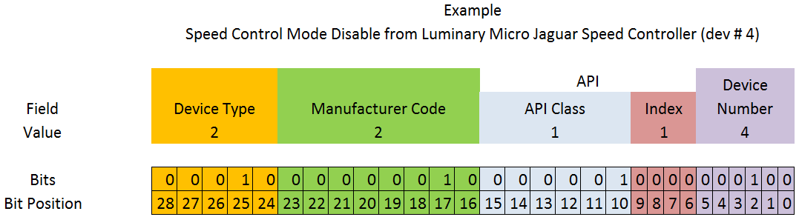

# Tools

Este directorio contiene utilidades auxiliares para el bus CAN: la decodificación de identificadores de comunicación usados en sistemas FRC / REV Robotics y el firmware del gripper.

## Contenido

### `decode_arbitration_id.py`
Este script decodifica un CAN Arbitration ID extendido de 29 bits y lo separa en sus campos principales:

- Device Type
- Manufacturer Code
- API Class
- API Index
- Device Number

Es especialmente útil para interpretar IDs de dispositivos como los motores SPARK MAX y otros componentes de la plataforma REV.

### `esp32_tmc2209/`
Firmware del gripper: una ESP32 que mueve la muñeca (motor a pasos con TMC2209) y la pinza (servo) con órdenes por CAN, como un dispositivo más del bus de los SPARK MAX. Sus IDs siguen el mismo formato; por ejemplo, `0x0A080805` es el `STATUS_0` del gripper (tipo 10, fabricante 8, clase 2, índice 0, dispositivo 5). Conexiones, tramas, parámetros y pruebas en su [README](esp32_tmc2209/README.md).

---

## ¿Qué hace?

El script recibe un ID hexadecimal o decimal, lo interpreta como un valor de 29 bits y luego muestra:

- El valor completo del Arbitration ID
- Su representación binaria
- Cada campo extraído del ID con:
  - valor decimal
  - valor binario

Esto permite analizar rápidamente la estructura interna del identificador sin tener que hacer la separación manual bit a bit.

---

## Estructura del ID

El formato estándar que se decodifica es:

- Bits 28-24 → Device Type
- Bits 23-16 → Manufacturer Code
- Bits 15-10 → API Class
- Bits 9-6 → API Index
- Bits 5-0 → Device Number

---

## Example

La siguiente ilustración muestra cómo se divide un Arbitration ID de 29 bits en sus campos principales para un dispositivo REV.



---

## Uso

Ejecuta el script desde la terminal:

```bash
python decode_arbitration_id.py
```
